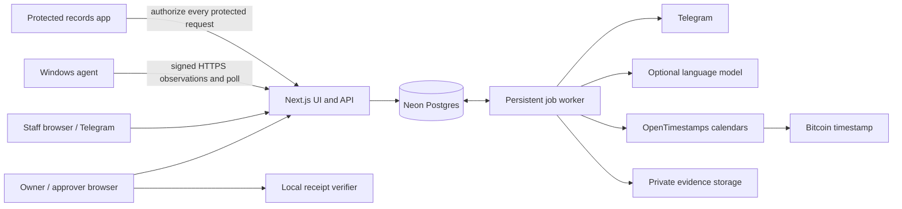

# VAJRA Saathi - complete build plan

Version 1.0 | 31 October 2026 | Design specification, not a claim of implemented functionality

Companion documents: [Product journeys](flow.md) and [Plain-language-to-technical explanation](output/pdf/idea.pdf).

## 1. What we are building and why

Saathi is a security teammate for a small organization without a dedicated security team. It observes connected computers and applications, reduces repetitive alerts, explains an incident in everyday language, previews the consequences of a response, executes an authorized action, checks its outcome, guides recovery, and preserves independently verifiable evidence.

The central promise is: **understand the problem, see who a response affects, stop the unwanted activity within connected systems, and keep legitimate work going wherever possible.** Never promise universal protection, perfect detection, or knowledge of unconnected systems.

The product is organization-neutral. Schools, clinics, shops, NGOs, small offices, and service businesses use the same engine. A vocabulary pack changes labels such as student records, patient records, customer records, or business records. It does not change authorization semantics or detection correctness.

This plan covers the whole agreed product. The order below produces a working vertical slice early and then completes the remaining modules. The demo priority is not permission to leave the full product undefined. Follow every phase for the complete prototype; use the final release gates to distinguish a prototype from a production deployment.

### Users and responsibilities

| Role | Product use | Authority |
|---|---|---|
| Owner | Enrol organization, set policy, manage approvers and recovery | Membership, integrations, auto-guard policy, sensitive recovery |
| Approver | Review alerts and approve permitted responses | Scoped incident actions after fresh authentication when required |
| Staff | Report a suspicious message and view own submissions | No device or account control |
| Auditor | Read assigned incident history and download permitted evidence | Read-only; no broad access to staff message content |
| Device agent | Send observations, receive and execute supported commands | One enrolled device only; never a human organization role |

An owner can also be an approver. Keep an independent recovery identity so containment cannot lock out every administrator. Authentication sessions for Saathi and sessions in a protected business application are different objects.

### Complete feature inventory

- Organization setup, language, working hours, timezone, roles, dependencies and coverage inventory.
- Windows event collection, device posture, heartbeats, offline queue and supported response actions.
- A protected demonstration records application and a documented integration contract for real business software.
- Noise reduction, explainable correlation, incident prioritization and a weekly digest.
- Facts, uncertainty, recommended response and consequence preview in English, Kannada and Hindi.
- Policy-approved temporary throttling; human approval for broader interventions.
- Verified outcomes, incomplete/failed outcomes, recovery and old-session rejection.
- Ask Saathi: text/screenshot scam assessment, staff reporting and organization-level campaign grouping.
- Device health score, previewed fixes, action history and coverage/freshness display.
- Telegram notifications, browser read-aloud where a suitable voice exists, and accessible mobile UI.
- Signed evidence, retained checkpoints, offline integrity verification, and asynchronous Bitcoin timestamp anchoring.
- Reports, evaluation harness, clearly labelled replay mode and a repeatable live demonstration.

## 2. Architecture and selected stack

Use one TypeScript domain layer shared by the web server and worker. Do not build independent frontend, API and worker interpretations of security policy.

| Layer | Selection | Purpose and rationale |
|---|---|---|
| Web and API | Next.js App Router, React, TypeScript, Node runtime | Mobile product, server rendering, authenticated Route Handlers |
| Database | Neon PostgreSQL | Durable organization data, policy state, incident/action records and jobs |
| SQL access | Drizzle ORM with `pg` | Typed schema and real interactive transactions on one checked-out connection |
| Identity | Better Auth with database sessions | Login, session lifecycle and invitations; authorization remains in Saathi services |
| Frontend | Tailwind, shadcn/ui, SWR, next-intl | Accessible components, polling and reviewed language templates |
| Validation | Zod | Shared input/output schemas and bounded command parameters |
| Worker | Separate persistent Node/TypeScript process | Detection, notifications, command signing, evidence signing, retries, reports and anchoring |
| Windows collector | Node/TypeScript with fixed PowerShell adapters | Event logs, posture, authenticated transport and bounded local queue |
| Windows lock helper | Small C#/.NET interactive-session companion | Session-aware lock request and WTS lock/unlock notification; avoid pretending a service is an interactive desktop |
| Evidence | SHA-256, Ed25519, versioned canonical JSON | Integrity, signer verification and linked evidence history |
| Blockchain | OpenTimestamps through its Python client in the worker image | Existing Bitcoin timestamp protocol; no custom token, wallet flow or smart contract |
| AI | Anthropic SDK behind a provider adapter; model selected through environment | Optional explanation/OCR assistance with strict schema and deterministic fallback |
| Notifications | Telegram Bot API | Minimal alert plus authenticated deep link; no approvals in chat |
| Attachments | Private S3-compatible object storage | Temporary screenshots and evidence archives; authenticated short-lived downloads |
| Testing | Vitest, fast-check, Playwright | Policy properties, database races, UI journeys and integration validation |
| Deployment | Vercel for Next.js; persistent container host for worker; Windows device agent | Separate web request lifecycle from durable background execution |

Pin tested versions in the lockfile. The workspace currently has Next.js 16.4.3 in its package manifest; that is context, not a requirement to modify the existing application. Implement Saathi in a separate application directory/repository unless deliberately integrating it. Read the installed Next.js guides before code changes. Avoid claiming any tool choice itself increases winning odds; the value is in observable behavior.

### Connections



The worker writes signed commands to Neon; the agent fetches them through the API. The browser cannot connect directly to Neon, send PowerShell, hold signing keys, or publish blockchain transactions. The records gateway enforces restrictions synchronously. Background detection can add context, but must not be the only mechanism limiting a burst of downloads.

### Suggested repository layout

```text
apps/web/src/app/             pages, layouts, api Route Handlers
apps/web/src/components/      cards, previews, status, navigation
apps/web/src/server/          auth context, DAL, application services
apps/worker/src/              job handlers, schedulers, adapters
apps/agent/src/               collector, spool, transport, executor
apps/agent/windows-helper/    interactive session companion
packages/contracts/          Zod schemas, event/action types, error codes
packages/domain/             authorize, preview, correlation, recovery
packages/db/                 Drizzle schema, queries, migrations
packages/evidence/           canonical bytes, hashes, signatures, verifier
packages/i18n/               EN/KN/HI keys and vocabulary packs
tools/anchor/                pinned Python OpenTimestamps client wrapper
tests/fixtures/              synthetic organizations and replay events
tests/integration/           real database and worker tests
tests/e2e/                   browser journeys
docs/                       threat model, adapters, operations, evaluation
```

## 3. Contracts to settle before implementation

### Shared vocabulary

- **Event:** a source observation, with source identity and time. Not proof of malicious intent.
- **Signal:** a normalized event or counted pattern, with provenance.
- **Incident:** correlated signals requiring a decision or review.
- **Session:** one authenticated login to a specific application/device context.
- **Capability:** an operation such as `records.download` or `device.interactive_use`.
- **Preview:** predicted restrictions, unaffected known capabilities, unknown dependencies, reversibility and freshness.
- **Action:** an approved, bounded change to policy or a device.
- **Probe:** evidence about the state after execution. A command exit code alone is insufficient.
- **Checkpoint:** signed sequence number and evidence-chain head retained outside the database.
- **Anchor:** external timestamp proof for a commitment to a checkpoint.

### State machines: keep these independent

```text
Incident: open -> investigating -> contained -> recovering -> recovered
          open/investigating -> dismissed (reason required)
          contained/recovering/recovered -> investigating (new relevant evidence)

Action: requested -> queued -> executing -> confirmed | partial | failed | unknown
        requested/queued -> expired | cancelled
        unknown -> confirmed | partial | failed (reconciliation, never blind rerun)

Evidence: pending_signature -> signed | signing_failed
Anchor: not_requested -> pending -> submitted -> confirmed
        pending/submitted -> retrying | failed
        any received proof -> invalid if verification fails
```

`confirmed` means the particular action's postcondition was observed. `contained` means every currently identified in-scope harmful capability has a verified restriction. Unknown coverage can prevent that conclusion. Throttled downloads mean reduced exposure, not fully stopped downloading. Closing an incident does not erase its history. Expired commands cannot execute later when a laptop reconnects.

### API conventions

All routes are under `/api/v1` except the authentication library handler. JSON requests are validated, size-limited and authorization-checked. UTC timestamps are stored; organization timezone is used for display and after-hours rules. Use opaque UUIDs, cursor pagination, `requestId`, server time and source freshness in responses. Set sensitive responses to `Cache-Control: private, no-store`. Never opt organization data into shared Next.js caches.

Success: `{data, requestId}`. Error: `{error:{code,message,retryable},requestId}`. Common codes: `UNAUTHENTICATED`, `FORBIDDEN`, `NOT_FOUND`, `STALE_PREVIEW`, `COVERAGE_UNKNOWN`, `DEVICE_OFFLINE`, `UNSUPPORTED_ACTION`, `RATE_LIMITED`, `DEPENDENCY_UNAVAILABLE`. Use 409 for stale/conflicting state, 422 for invalid supported input, 429 for limits, and 503 for unavailable dependencies. Avoid revealing another tenant's object existence.

Every mutation validates current membership and target ownership. Browser mutations check same-origin/CSRF protection. Device requests authenticate separately. Telegram webhook requests validate the configured webhook secret and deduplicate update IDs. An organization ID supplied by a client is a selector, never proof of authority.

## 4. Database plan

Use `timestamptz`, explicit enums or checked status values, indexes on tenant plus time/status, and foreign keys that prevent cross-tenant references. Store identifiers and minimized facts rather than full business records in security logs. Schema below is the logical model; authentication-library tables retain its required shape.

| Tables | Important columns and relationships |
|---|---|
| auth users/sessions/accounts | Library-managed login identity; isolated from protected-app sessions |
| organizations, memberships, invitations | `org_id`, role, locale, timezone, state, membership version |
| org_policy, policy_guards | Auto-guard consent/version, working hours, thresholds, revision rows for locking |
| staff, integrations, dependencies | Subject status; connector capabilities; declared dependency edges, author and freshness |
| devices, device_keys, enrollment_codes | Owner org, status, heartbeat, supported capabilities, key version, one-use code hash |
| device_accounts, device_posture | Local SID, role, facts, observed time, unknown fields, posture revision |
| app_sessions, grants, access_counters | Integration/subject/session, revocation, restrictions, atomic rate budget |
| demo_records | Synthetic data only; all downloads pass through authorization |
| raw_events, signals, event_dispositions | Source cursor, boot/log epoch, event ID, type, count, reason for suppression |
| incidents, incident_signals | Rule/version, scope, observed/uncertain/boundary keys, containment assessment |
| previews | Actor, target, action parameters, state hash, policy version, expiry, stored consequence set |
| actions, action_probes, agent_commands | Unique preview reference, idempotency key, expected postconditions, command nonce/expiry |
| jobs, outbox | Durable type/payload reference, dedupe key, lease, attempt count, retry time, error |
| notifications, telegram_links | Delivery state, private chat binding, one-time link code hash |
| scam_checks, campaign_reports | Tenant-keyed content fingerprint, normalized domains, findings, reporter, retention |
| evidence_intents, evidence_entries, checkpoints | Ordered org sequence, canonical payload, previous hash, signature/key ID |
| anchor_batches, anchor_members, anchor_proofs | Randomized commitments, root, inclusion paths, OTS bytes, verified block reference |
| reports, recovery_cases | Manifest version, artifact reference, required steps and verification results |

Constraints: unique `(device_id, log_epoch, channel, native_event_id)`; unique `(org_id, preview_id)` for an action; unique `(org_id, idempotency_key)`; unique command nonce per device; unique evidence sequence per organization; dedupe keys on jobs and notifications. Store session secrets as hashes where the application owns their format. Use an encryption key outside Neon for retrievable device HMAC secrets and integration credentials.

Use separate migration and application database roles. Enforce tenant scoping in the DAL and PostgreSQL RLS as defense in depth: non-owner runtime role without `BYPASSRLS`, transaction-local tenant context set from authenticated membership, and forced policies where applicable. Test jobs with explicit tenant context. Never trust a client-provided session variable. Global job claiming uses a restricted worker role/procedure; claims return tenant IDs, and tenant data is accessed through a tenant-scoped transaction. Document the worker's broader trust boundary.

## 5. Ordered implementation phases

Each phase states what to build, how layers connect, and the gate before calling it finished. Commit a working increment after each gate. Carry tests forward; do not wait until the end to discover a policy mismatch.

### Phase 00 - freeze promises and prove the risky integrations

1. Write the threat model: stolen application session, unauthorized physical use, password guessing, removable media, malware alerts, offboarded accounts, scam messages, compromised server/key and missing integrations.
2. For each threat, state what Saathi sees, what it can change, and what remains outside its control.
3. On an authorized test Windows PC, read actual failed-logon events, identify logging prerequisites, inspect removable storage, and prove session-specific lock notification through the interactive helper. Windows Hello and different login methods may not produce the same observations: test the selected demo path.
4. Submit a synthetic checkpoint to OpenTimestamps early and retain the pending proof. Confirmation can take longer than a presentation; keep polling in the eventual worker.
5. Decide supported Windows build, demo application boundary, and supported actions. Unsupported capabilities are visibly unavailable.

Gate: real event ingestion feasibility, a lock request with session-aware observation, and a pending timestamp proof exist. These are technical spikes, not production readiness. Use only synthetic records and authorized devices.

### Phase 01 - scaffold, environments and continuous checks

1. Create the separate Saathi workspace and packages above. Initialize TypeScript strict mode, linting, Vitest and Playwright.
2. Create Neon development/test/demo branches. Use pooled TLS connection strings for app traffic and a direct migration connection. Keep `pg` pools small; use one checked-out client for an entire transaction.
3. Configure web and worker separately. Add `dev:web`, `dev:worker`, `dev:agent`, `db:migrate`, `db:seed`, `test`, `test:integration`, `test:e2e`, `typecheck` and `build` scripts.
4. Add environment validation and `.env.example` with names only. Fail clearly when required settings are missing.
5. Read local Next.js Route Handler, server/client, security and caching guides. Use async request APIs and params according to the installed version. Keep database imports in server-only modules.

Environment contract: `DATABASE_URL`, `DATABASE_URL_DIRECT`, `BETTER_AUTH_SECRET`, `BETTER_AUTH_URL`, `APP_ORIGIN`, `WORKER_ID`, `DEVICE_SECRET_ENCRYPTION_KEY`, `COMMAND_SIGNING_KEY_ID`, `COMMAND_SIGNING_PRIVATE_KEY`, `EVIDENCE_SIGNING_KEY_ID`, `EVIDENCE_SIGNING_PRIVATE_KEY`, `TELEGRAM_BOT_TOKEN`, `TELEGRAM_WEBHOOK_SECRET`, `ANTHROPIC_API_KEY`, `AI_MODEL`, `OBJECT_STORAGE_*`, `OTS_CALENDAR_ALLOWLIST`, `BITCOIN_RPC_*` (when operating an independent verifier), and `DEMO_MODE`. Private signing keys belong to the worker secret store, never `NEXT_PUBLIC_*`.

Gate: clean build; web and worker connect to test Neon; no secrets in the client bundle or repository.

### Phase 02 - identity, tenancy and organization setup

1. Integrate Better Auth database sessions. Require fresh server-side session validation on sensitive operations; avoid a stale cookie cache granting authority after revocation.
2. Build `/login`, `/onboarding`, organization switcher, membership invitations and role checks.
3. Onboarding collects type, timezone, working hours, preferred language, notification preferences and an owner recovery contact/identity. Present auto-guard consent separately with explicit scope and expiry behavior.
4. Build dependency input: “This workstation runs billing”; “these people share this account”; “this app is connected/read-only/unconnected.” Record that these are declarations, not discovered truth.
5. Implement `requireActor`, `requireOrgRole`, `withOrgTransaction` and minimal DTO helpers. Reuse them in every UI loader and API.

Gate: a user from organization A cannot read, preview or mutate any B object even by guessing IDs. Staff cannot invoke approver endpoints. New organizations correctly show zero coverage, not “all safe.”

### Phase 03 - schema, audit intent and durable job infrastructure

1. Migrate foundational tables, then incidents/actions/evidence/jobs. Seed one generic organization and three vocabulary variants with synthetic data.
2. Insert state changes and their `evidence_intents` plus outbox jobs atomically. Critical mutations fail if this write fails; never execute an unaudited remote command.
3. Worker claims due jobs in short transactions using row locks and `SKIP LOCKED`, writes a lease, commits, then does external I/O outside the transaction.
4. Use bounded exponential backoff with jitter, lease expiry, idempotent handlers and a visible failed-job queue. A process crash returns work to the queue.
5. Heartbeats and scheduler jobs create reminders, stale-agent assessments, digest tasks and anchor upgrades. Do not use `after()` as a durable queue; request lifetime is not a reliability guarantee.

Gate: kill/restart the worker during a notification and an evidence task. No accepted event is lost, no double command is executed, and failure is inspectable.

### Phase 04 - protected business application and policy engine

1. Build `/workspace/records` as a labelled reference integration. Include two sessions for one staff member and different grants. Keep this distinct from the security console.
2. Implement pure `authorize(snapshot, request)` returning `allow`, `deny`, or `throttle` with reason and version. Account status, integration, tenant, session revocation, scope and limits all matter.
3. Route every protected download through the gateway. Do not expose permanent object URLs that bypass checks. Define the boundary: authorization occurs per request; already delivered bytes cannot be recalled.
4. Serialize related policy changes and rate-budget reservations through `policy_guards`. A subject guard is locked by session creation/revocation, grant changes, preview approval and protected requests. Organization policy changes also take the relevant policy guard. Use a consistent lock order.
5. Reserve rate budget atomically before serving data. When the configured burst rule triggers, apply consented throttling in that transaction and enqueue incident processing. Concurrent requests must not bypass the budget.

Gate: paused/revoked sessions are denied, legitimate sessions keep working, old tokens fail, and concurrent bursts obey the limit. Database unavailability produces “service unavailable” for protected requests, not bypass access.

### Phase 05 - event ingestion and device enrollment

1. Owner requests a short-lived one-use enrollment code. Store its hash and show it once.
2. Agent exchanges it over TLS; the server atomically consumes it and binds the device to that organization. Store the device secret with OS protection and restrictive file permissions; pin approved command verification keys.
3. Sign device requests over method, path, timestamp, nonce and body hash using per-device HMAC. Validate time window, key version, nonce uniqueness, size and device status before ingest.
4. Accept a bounded batch, insert deduplicated raw events and processing jobs together, then acknowledge accepted cursors. Repeated transport delivery is safe.
5. Local agent spool preserves unsent observations with an explicit size cap and dropped-event counter. Persist source bookmarks including log reset/epoch; record both observed and received times.
6. Separate heartbeat from event volume. A silent computer may be healthy or disconnected; the UI must know which.

Gate: enrol once, reject reuse, reject spoofed requests, restart the agent without re-importing old events as new, and reconnect after an outage with visible delay.

### Phase 06 - normalize, filter and correlate

1. Normalize observations to versioned types: `auth.failed`, `auth.succeeded`, `account.created`, `account.admin_added`, `storage.attached`, `malware.detected`, `malware.remediated`, `protection.disabled`, `records.download`, `decoy.access`, `message.reported`.
2. Deduplicate exact repeats. Aggregate repeated failures while retaining their count; otherwise dedupe can erase the threshold signal.
3. Attach a disposition to every event: correlated, aggregated, digest, informational or rejected. Store reasons so the noise funnel is inspectable.
4. Working-hours/known-device baseline reduces priority only where appropriate. Never suppress explicit malware, offboarded-account access or threshold breaches merely because the device is familiar.
5. Group failed logins and a nearby storage event by a documented device-security family, not separate rule IDs that cannot merge. Preserve each underlying finding and its own boundaries.
6. Suppress only narrowly matched expected effects of a specific Saathi command, within a bounded time window. Do not ignore all events from a device after acting.

| Rule | Initial prototype preset | Response semantics |
|---|---|---|
| Password guessing | At least 5 failures on a device in 5 minutes | Review; lockout policy/source restriction only where supported and justified |
| Possible compromise | Failures followed by relevant success/admin creation within 15 minutes | Escalate uncertainty-aware review; no automatic broad account disable |
| Removable media | Storage attached after hours or near suspicious login activity | Show device policy options and already-mounted boundary |
| Bulk records access | 20 attempts/120 seconds or 100/day per session | Atomic temporary throttle when consented; offer session pause |
| Former staff access | Any protected request by offboarded subject | Deny by access policy and record attempted access |
| Decoy record | Access to a synthetic decoy | Review signal; never proof of intent |
| Unresolved malware | Detection without matching remediation after 2 minutes | Review and supported scan action; scanner completion is not proof of eradication |
| Protection disabled | Defender/firewall posture reports disabled | Preview restoration; report policy/tamper-protection failure honestly |
| Repeated scam | Three distinct staff reports of matching normalized campaign within 24 hours | Offer an internal warning to authorized recipients |

Thresholds are starting presets, not validated detection performance. Version changes and evaluate them against representative normal and suspicious data. Dedupe warnings and use urgency tiers: needs attention, review today, weekly information.

Gate: a labelled replay explains every count in the funnel. Known-normal activity is tested alongside attacks; missed incidents and false positives are reported.

### Phase 07 - build the consequence engine before approval buttons

1. Define a snapshot of known subjects, sessions, grants, devices, current restrictions and declared dependencies. Include freshness and coverage gaps.
2. Implement `applyActionToSnapshot` as a pure state transition. Evaluate the same relevant request set with `authorize` before and after.
3. Partition consequences into `stops` (allow to deny), `limits` (allow to throttle or stricter limit), `keepsWorking`, `unknown`, `cannotControl` and `undo`. Do not claim equality of binary decisions when throttling is a distinct state.
4. Choose the least disruptive supported action meeting the explicit containment/reduction objective. If no action meets it, say so; do not manufacture a recommendation.
5. Store actor, exact parameters, relevant state/version, expiry and preview content in Neon. Device previews are predictions from an observed snapshot, not guaranteed equivalence with Windows behavior.
6. Display the snapshot's timestamp. Missing dependencies become “Impact on unconnected applications is unknown,” not “Nobody else affected.”

Example contract (illustrative, not library-specific):

```ts
type Preview = {
  id: string; actionType: string; targetId: string;
  stops: Consequence[]; limits: Consequence[];
  keepsWorking: Consequence[]; unknown: string[];
  cannotControl: string[]; undo: RecoveryRequirement[];
  stateHash: string; policyVersion: number; expiresAt: string;
  coverage: { scope: string[]; observedAt: string; completeForScope: boolean };
};
```

Gate: property tests compare predicted and actual policy transitions over randomized states, including deny/throttle/allow, multiple sessions, dependencies and missing coverage.

### Phase 08 - transactional approval and application actions

1. Browser submits only stored preview ID and idempotency key; never trust a client-recomputed consequence set.
2. In one transaction, revalidate actor/role, lock the preview and the policy guard rows, check expiry, and re-read the relevant state. All competing writers must follow the same guard protocol to prevent new-session phantom races.
3. If state changed, return `409 STALE_PREVIEW` without an action; render a new preview requiring a fresh decision. Unrelated changes do not invalidate it.
4. If valid, create the unique action, apply application policy changes, write evidence intent and outbox tasks, then commit. Duplicate taps return the same action.
5. Probe resulting authorization using side-effect-free checks against actual committed state and controlled integration requests. Never download private data merely to probe access.
6. Recompute the incident containment assessment using all relevant findings. A successful partial fix leaves the remaining concern visible.

Gate: session creation racing with approval is serialized or invalidates approval; duplicate taps cannot duplicate application; revoked approvers fail; an injected failure cannot produce “contained.”

### Phase 09 - Windows commands and behavioral verification

Build one adapter at a time. Each exposes `supports`, `preview`, `executeDesiredState`, `probe`, `recover` and boundaries. The agent accepts no arbitrary executable, script body, filesystem path or command line from the server.

| Action | Implementation approach | Required evidence / limitation |
|---|---|---|
| Lock interactive session | Privileged service coordinates with authenticated, ACL-restricted local helper in target user session | Observe matching session lock notification; does not stop all processes or network activity |
| Disable local account | Fixed local-account adapter using SID identity | Enabled flag plus new-login denial where testable; existing sessions are separately assessed |
| Restrict removable storage | Supported Windows policy adapter, explicit class/scope, saved prior state | Verify effective policy and controlled read/write behavior; mounted devices may remain accessible |
| Enable firewall | Fixed profile-specific adapter | Effective profile state; not proof every unwanted connection is blocked |
| Set lockout policy | Bounded validated threshold/duration | Read effective policy; document potential staff lockout and recovery |
| Block source IP | Narrow named firewall rule, validated address and direction | Effective rule and controlled matching probe; rule existence alone is insufficient |
| Enable AV protection | Supported Defender adapter | Effective posture or clear managed/tamper-protection denial |
| Request AV scan | Fixed scan type and bounded lifecycle | Scan accepted/running/completed status, separate from infection-clear assessment |
| Undo supported changes | Restore saved prior state only if current state still matches Saathi-owned change | Avoid overwriting subsequent administrator policy changes |

Command envelope: `{schemaVersion,id,orgId,deviceId,actionId,type,params,expectedStateHash,issuedAt,expiresAt,nonce,keyId,signature}`. Sign canonical bytes without the signature field using the dedicated command key. The agent checks target, signature, allow-list, parameter bounds, expiry, expected local state and persistent replay ledger. Protect last enabled admin, recovery identity and the agent's own operating identity.

Persist command receipt before execution. Redelivery of the same command returns its existing result; it does not rerun. After a crash between applying a change and recording success, inspect desired state and reconcile; otherwise report unknown. Server accepts result transitions idempotently and rejects contradictory late messages without review.

Start with short HTTPS polling (for example 2 seconds when active, backoff when idle/offline) rather than holding serverless requests indefinitely. Commands expire after a short configured window such as 60 seconds; offline devices need new approval after expiry. Device revocation stops new command delivery. A previously delivered valid command may still execute before expiry: state this boundary.

Gate: live device action matches its stated postcondition; bad signature, wrong device, reused nonce and expired command fail; unsupported behavior never produces a green confirmation.

### Phase 10 - frontend incident experience and localization

1. Build navigation in `flow.md`: overview, incidents, devices, people/access, Ask Saathi, health, evidence/reports, integrations and settings.
2. Server Components load minimal authorized DTOs from the DAL. Interactive components call Route Handlers; both reuse the same application services. Do not make server components call their own HTTP endpoints unnecessarily.
3. Poll active incidents/actions with SWR, briefly and with backoff. Revalidate after mutations. Do not optimistically show a security action as successful.
4. Incident detail renders observed facts, uncertainty, scope, recommendation, alternatives and the preview. Loading, empty, stale, partial and failure states are first-class screens.
5. Store template keys and structured parameters. Use reviewed EN/KN/HI translations, vocabulary packs, appropriate fonts and locale dates. Do not generate core warnings afresh with an LLM.
6. Support keyboard navigation, clear focus, readable contrast, text labels beside colors and touch targets. Use speech synthesis only when a matching installed voice exists; otherwise show text and explain audio unavailability.

Gate: a non-technical participant can identify the affected session, select the narrow action, and explain who keeps access. Mobile and desktop show the same authorized state.

### Phase 11 - auto-guard, reminders and recovery

1. Model consent as versioned policy with named actions, thresholds, scope, maximum duration and expiry behavior. Default broad interventions to off.
2. Implement the gateway throttle as an explicitly temporary restriction. For the initial policy, it expires after 30 minutes with visible countdown and an audit event; warn before expiry and notify if suspicious behavior continues. No silent conversion into an indefinite pause.
3. A human-approved pause/revocation has its own lifecycle and does not expire with the throttle. Reminders escalate for review, not automatic broadening of access or restrictions.
4. Recovery asks the owner to verify the staff member through a trusted channel, secure credentials as appropriate, inspect remaining findings, and issue a fresh application session. Old paused sessions are revoked permanently, never resumed.
5. Device recovery previews the restore action, verifies current ownership of the policy change and checks the result. Only mark recovered once required checks pass.

Gate: countdown behavior is deterministic; policy expiry, escalation, blocked recovery and old-token replay are tested. A timeout cannot resurrect a revoked session.

### Phase 12 - Telegram delivery and staff reporting

1. Authenticated owner generates a one-use linking code; the bot exchange binds a private chat to the user/org. Do not infer identity from Telegram display names.
2. Notification job sends generic text such as “An office device needs review.” Link to login and then the authorized incident; the URL is not a bearer approval token.
3. Retries reuse notification identity and record delivery state. Alert delivery failure does not roll back detection; show it in the console.
4. Staff reports enter through a linked bot conversation or `/ask`. A campaign warning requires authorized review, scoped recipients and delivery history; no arbitrary mass messaging.

Gate: duplicate webhooks do not duplicate reports; a forwarded alert link cannot bypass login; chat unlinking prevents new deliveries.

### Phase 13 - Ask Saathi and optional AI explanations

1. Accept pasted text and bounded image uploads. Validate MIME using file content, size and dimensions; store images privately with short retention. Let the user preview/redact extracted text before external AI submission.
2. Normalize URLs and domains including Unicode/punycode. Run deterministic evidence checks and optional reputation lookups. A short URL, unusual TLD or urgent wording is a risk signal, not proof of fraud.
3. Avoid fetching arbitrary submitted URLs in the prototype. If later needed, use an isolated fetcher with SSRF defenses and redirect/IP checks. Never let a webpage's instructions control tools.
4. Return `known_malicious`, `suspicious`, `no_known_indicators`, or `insufficient_information` with reasons and next steps. Never translate “no known indicators” into “safe.”
5. LLM gets minimized approved text, fixed findings, allowed explanatory vocabulary and schema. It has no tools, credentials or path to action authorization. Validate output and render it as text, never executable HTML.
6. Incident “Explain more” is optional. Templates remain usable if AI is unavailable. Bound latency/cost and use a circuit breaker. Select a currently available model through `AI_MODEL`; do not embed an unverified model ID in the architecture.
7. Retain structured findings and a tenant-keyed fingerprint where appropriate; do not treat a plain hash of a predictable private message as anonymization. Delete raw attachments on the stated schedule.

Gate: prompt-injection messages cannot invoke actions; benign messages with short links are not automatically declared scams; missed and overflagged messages are measured separately.

### Phase 14 - posture, health and weekly digest

1. Collect AV, firewall, update freshness, lockout settings, unnecessary admin exposure and remote-access posture. Each result is pass/fail/unknown with timestamp and source.
2. Use transparent versioned weights: AV 25, firewall 25, updates 20, lockout 10, admin exposure 10, remote access 10. Award passed points and display unknown points/coverage separately. A posture score is not a probability of safety.
3. A fix opens the same preview/approval/action machinery. Unsupported updates show guided instructions; do not promise every setting is a one-tap fix.
4. Weekly digest summarizes meaningful incidents, remediated detections, outstanding recovery, coverage gaps and policy expiry. Generate the content from stored facts, not invented AI summaries.

Gate: a disconnected device cannot increase its score; unknown checks are visible; a failed fix cannot improve the displayed posture.

### Phase 15 - signed evidence and offline integrity verifier

1. Worker signs evidence intents in monotonic organization sequence. Serialize appends on the organization's chain-head row; a missing earlier intent blocks later signing and raises an operational error.
2. Define canonical serialization version 1: fixed field names, deterministic key order, UTF-8, normalized timestamps, no floating-point ambiguity. Hash `{schemaVersion,seq,orgRef,type,occurredAt,recordedAt,payload,prevHash}` and sign that hash with Ed25519.
3. Use database permissions and triggers to resist ordinary edits, but acknowledge a privileged database operator can bypass them. External checkpoints supply a different trust boundary.
4. Package a minimal incident export with signed entries, hash links, public key IDs and a signed checkpoint. For the prototype, export the complete minimized organization chain to that checkpoint only to owners/auditors; restrict it to synthetic demo data. A production incident-only export needs a designed inclusion proof or separate incident chains so unrelated incidents are not disclosed.
5. Trust keys from a separately distributed verifier/pinned key registry, never solely from an uploaded bundle. Document key rotation and historical keys. A QR may contain checkpoint reference/hash/signature; the full proof bundle is downloaded separately.
6. Build `/verify` as local file processing and a downloadable standalone verifier with bundled code/fonts/keys. A page not previously loaded cannot magically work offline. Verify hash recomputation, ordering, links, signatures and retained checkpoint match.
7. Treat report PDF as a readable view. Canonical evidence is a versioned manifest/JSON bundle; include a digest of exact PDF bytes in a separate signed export manifest if verifying that PDF file itself. Do not create a self-referential file hash.

Gate: edit, reorder, wrong-key, middle deletion and tail truncation tests fail appropriately; unsigned/incomplete evidence cannot be labelled verified. Retaining a checkpoint independently catches truncation to an earlier valid chain.

### Phase 16 - blockchain anchoring through OpenTimestamps

Purpose: publish an external timestamp commitment so a later rewritten history cannot match a previously confirmed reference. This is an additional trust reference, not a detector or a truth oracle.

1. For each signed checkpoint, generate a random 32-byte nonce and form a domain-separated commitment: `SHA256("saathi-checkpoint-v1" || nonce || canonicalCheckpointBytes)`. Save nonce privately in the verification bundle. Publish no names, IDs, business records or unsalted predictable fields.
2. Batch commitments into a deterministic Merkle tree. Define leaf hashing, internal-node hashing, ordering and odd-leaf behavior explicitly; use domain prefixes to distinguish leaves and internal nodes. Store each membership path and batch version. Batching reduces public metadata and workload.
3. Write the exact root bytes to a bounded worker-generated temporary file. Invoke the pinned official Python client with an argument array, never a shell string containing user input. The OTS client stamps that file's digest; record exact bytes and algorithm so verification uses the same file.
4. Persist the returned `.ots` proof immediately. A calendar receipt is `submitted/pending`, not Bitcoin-confirmed. Schedule proof upgrades with backoff and bounded network calls.
5. When Bitcoin attestation is available, verify through the supported OTS client using a configured Bitcoin node. For an independent production verifier, operate your own validating node. If using a remote verification service in a prototype, label that trust dependency rather than calling it fully independent.
6. Store proof version, block reference, verification method/time and confirmation policy. Recheck on suspected reorgs and downgrade status if the current chain no longer supports the proof. Calendar receipt time and block timestamp are not exact incident times.
7. Export nonce, checkpoint, Merkle path, batch-root bytes and `.ots` proof. Local `/verify` checks integrity/membership offline. Bitcoin chain validation requires a trusted node or independently validated chain context; show “Blockchain timestamp not checked offline” when that context is absent.
8. Provide status/retry UI and a ready confirmed synthetic example for the stage demo. A live incident can legitimately remain pending. Core detection and protection do not wait for this service.

Independent verification recipe: verify the signature and retained checkpoint; recompute the salted commitment; verify the Merkle path to the root; reconstruct the exact root file; use the OTS proof and validating Bitcoin node to confirm its timestamp. A transaction explorer link is supplementary evidence, not a verifier.

It proves a commitment existed by the anchoring point and the supplied evidence matches it. It does not prove log truth, event completeness, exact event time, effective containment or legal compliance. It cannot restore a deleted evidence bundle. No custom smart contract or cryptocurrency purchase by the customer is required for this design.

Gate: valid confirmed proof verifies independently; changed checkpoint/nonce/path fails; pending proof is never called confirmed; calendar/node outage cannot block incident handling.

### Phase 17 - reports, operational controls and deployment

1. Generate incident and weekly reports from authorized snapshots. Include scope, observed facts, uncertainty, action results, recovery, evidence integrity status and independent timestamp status as separate fields.
2. Store artifacts privately; authorize each download and expire links. Track accesses without exposing document content in logs.
3. Deploy web and worker in compatible regions near Neon. Run migrations as a controlled release step, then deploy compatible code. Do not run schema mutation in a request handler.
4. Health checks distinguish web availability, DB access, worker queue lag, agent freshness, notification delivery and proof-service availability.
5. Back up evidence bundles and restore test Neon/data/object-store combinations. Keep retained checkpoints independently available; public hashes do not provide backups.
6. Set explicit retention and deletion policies with organizations. Prototype defaults can be 7 days raw telemetry, 24 hours raw message images and 30 days minimized reports, but these are proposed product settings requiring validation, not legal rules. Explain that already-published commitments cannot be withdrawn.
7. Add owner-visible integration revoke/disconnect, device retirement, secret rotation and recovery access. Document what may remain active on a disconnected device and how an authorized local admin restores it.

Gate: deploy from a clean checkout, restart the worker, restore a synthetic incident and its proof, rotate a test key, and show monitoring of a failed dependency.

### Phase 18 - evaluation, complete-product acceptance and presentation

Execute the acceptance matrix below. Record actual results with run IDs, environment, sample sizes and failures. A prepared example is not a benchmark. Produce a short pitch only after the mechanism is repeatable.

Build the generic organization story first; demonstrate changing vocabulary to clinic/shop/school without changing policy. Ask a non-technical participant to predict the impact before approval. Keep incident protection and evidence trust as two separate claims.

Gate: all required modules pass; no hardcoded success counts; core live demo rehearsed repeatedly; replay/failure modes are labelled; roadmap integrations are not shown as implemented.

## 6. API inventory and frontend/backend wiring

Every resource operation below checks tenant and role. UI routes are specified in `flow.md`. Use OpenAPI generated from the shared schemas so frontend and worker contracts cannot drift.

| Endpoint | Caller and purpose | Writes / response |
|---|---|---|
| `/api/auth/[...all]` | Better Auth adapter | Library session flows |
| `POST /api/v1/organizations` | Owner onboarding | Org + owner membership + policy seed |
| `GET/PATCH /api/v1/organizations/:id` | Settings | Authorized profile and versioned preferences |
| `POST /api/v1/invitations` | Owner | Expiring membership invitation |
| `GET/PATCH /api/v1/members/:id` | Owner | Role/status; authority rechecked everywhere |
| `GET /api/v1/overview` | Console | Counts, coverage and freshness, no invented noise totals |
| `GET /api/v1/incidents` | Approver/auditor | Cursor-filtered incident cards |
| `GET /api/v1/incidents/:id` | Authorized viewer | Facts, findings, scope, timeline and action state |
| `POST /api/v1/incidents/:id/previews` | Approver | Persisted consequence preview |
| `POST /api/v1/actions` | Approver | `{previewId,idempotencyKey}` -> action ID/status |
| `GET /api/v1/actions/:id` | Authorized viewer | Current execution and probe assessment |
| `POST /api/v1/incidents/:id/dismiss` | Approver | Required reason; audit intent |
| `POST /api/v1/incidents/:id/recovery` | Owner/authorized recovery role | New recovery case/checklist |
| `POST /api/v1/recovery/:id/steps` | Authorized recovery role | Step result; server checks machine-verifiable claims |
| `GET /api/v1/devices` and `/:id` | Console | Inventory, posture, last seen and supported actions |
| `POST /api/v1/enrollment-codes` | Owner | One-use enrollment code |
| `POST /api/v1/agent/enroll` | Agent | Consume code, establish device identity |
| `POST /api/v1/agent/events` | HMAC device | Durable batch ingestion + accepted cursors |
| `POST /api/v1/agent/heartbeat` | HMAC device | Freshness and supported capability version |
| `GET /api/v1/agent/commands` | HMAC device | Nonexpired signed commands for that device |
| `POST /api/v1/agent/commands/:id/result` | HMAC device | Idempotent result + bounded probe facts |
| `GET /api/v1/people` and `/:id/sessions` | Approver | Staff, grants and integration-specific sessions |
| `POST /api/v1/access/previews` | Approver | Session/account restriction or offboarding preview |
| `POST /api/v1/devices/:id/previews` | Approver | Device action preview using same domain engine |
| `GET /api/v1/health` | Console | Score components, unknowns, coverage and suggested fixes |
| `POST /api/v1/scam-checks` | Linked staff/approver | Validated text/image reference -> findings |
| `GET /api/v1/scam-checks/:id` | Reporter or permitted reviewer | Verdict and permitted source details |
| `POST /api/v1/campaigns/:id/warn` | Approver | Scoped warning job, deduplicated recipients |
| `POST /api/v1/incidents/:id/explain` | Authorized viewer | Optional schema-validated explanation |
| `POST /api/v1/telegram/link` | Signed-in user | Expiring bot-link code |
| `POST /api/v1/telegram/webhook` | Secret-validated Telegram | Deduplicated link/report update |
| `GET/PATCH /api/v1/integrations/:id` | Owner | Coverage/capabilities, credentials write-only |
| `POST /api/v1/integrations/:id/events` | Connector identity | Idempotent source events |
| `GET /api/v1/records/:id/download` | Protected app session | Synchronous access check/rate reserve, then content or denial |
| `GET /api/v1/reports` | Owner/auditor | Permitted report metadata |
| `POST /api/v1/incidents/:id/report` | Owner/auditor | Export job and evidence snapshot reference |
| `GET /api/v1/reports/:id/download` | Authorized viewer | Short-lived private artifact download |
| `GET /api/v1/checkpoints/:id/anchor` | Authorized viewer | Pending/confirmed/failed status and trust method |
| `POST /api/v1/checkpoints/:id/anchor` | Owner or policy worker | Idempotent timestamp job request |
| `POST /api/v1/demo/replays` | Demo-only privileged role | Synthetic events; never enabled on production tenants |

For a real business-app integration, the app must enforce the decision at each protected operation, send authentic telemetry, identify sessions, expose bounded revoke/throttle capabilities and provide post-action probes. A read-only connector supplies visibility only. Do not make an integration “enforced” merely because an event webhook works.

## 7. Acceptance matrix

| Test | Required outcome |
|---|---|
| Cross-tenant object ID, session or job payload | No unauthorized read/write or evidence disclosure |
| Staff calls action endpoint; approver role revoked mid-flow | Denied server-side |
| Two sessions, pause only one | Target denied; other session unchanged |
| Account disable with existing sessions | Actual connector semantics shown; no unsupported claim of immediate universal logout |
| Concurrent session creation vs approval | Serialized consistent result or stale rejection; no phantom escape |
| Unrelated user's new session | Does not invalidate unrelated narrow preview |
| Duplicate approval / command/result delivery | Single logical action; consistent durable outcome |
| Concurrent download burst | Atomic budget prevents over-admission beyond defined policy |
| Agent offline / stale / local-state changed | Unavailable, expired or re-preview; no false confirmation |
| Command tamper, expiry, wrong device, replay | Rejected and recorded |
| Worker crash after external side effect | Reconciled or unknown; no blind destructive retry |
| USB already mounted / unsupported device class | Boundary visible; no false containment |
| One finding fixed, another unresolved | Partial protection; incident remains open/investigating |
| Expired auto-throttle | Visible expiry and audit; independent pause/revocation remains |
| Recovery and old token replay | Fresh session works; old token denied |
| Normal business-day replay | Measure false alerts and filtered reasons; no assumed perfect result |
| Slow extraction below thresholds | Record limitation and miss; do not claim complete prevention |
| Known benign and malicious messages | Confusion matrix, uncertainty and false positives reported |
| Prompt injection / AI down | No authorization path; deterministic templates still work |
| Evidence edit/reorder/truncate/wrong key | Integrity fails with a useful reason |
| OTS pending / tampered inclusion proof / node unavailable | Pending, invalid or unavailable; never fabricated confirmation |
| Offline verifier without Bitcoin chain context | Integrity check works; blockchain status explicitly unverified offline |
| Organization vocabulary switch | Same authorization outcomes; correct labels |
| Accessibility and language comprehension | Keyboard/mobile usable; native-reviewed critical copy |

Measure event-to-incident latency, action-to-probe latency, legitimate access preservation, false-positive/false-negative counts, job retry recovery and user decision accuracy. A 3-5 person pilot is descriptive evidence, not general proof. Publish medians/ranges and raw counts rather than unsupported “99% accurate” claims.

## 8. Delivery order, team ownership and demo

For a four-person team, assign web/UX/localization; policy/database/API; Windows agent/executor; and evidence/anchoring/evaluation. Agree contracts before separating work. Integration ownership belongs to one named lead. This is a suggested human team split, not an instruction to launch autonomous agents.

Critical path: contracts -> tenancy/database/jobs -> records authorization -> real event ingestion -> correlation -> preview -> action/probe -> recovery -> signed evidence -> anchor -> reports/evaluation. Run the Windows and anchoring spikes at the beginning because they have external timing risk. Complete Ask Saathi, health and multilingual/reporting modules after the core action loop is dependable.

Suggested hackathon checkpoints, not a guarantee of completing the full scope in 24 hours:

| Time budget | Observable checkpoint |
|---|---|
| First 2 hours | Contracts, DB/auth scaffold, Windows event spike, synthetic OTS submission |
| Next 4 hours | Connected device event and protected-app request appear in one console |
| Next 5 hours | Preview, narrow action, real enforcement, unaffected session and honest failure |
| Next 4 hours | Recovery, signed bundle, Telegram, reviewed primary language path |
| Next 4 hours | Anchoring status, Ask Saathi, health, report flows and negative-case tests |
| Remaining time | Fixes, user checks, rehearsals and freeze; no new infrastructure |

If a module misses its gate, label it incomplete. Do not silently replace a real mechanism with a mock and call it shipped. The full build plan remains the completion backlog.

Three-minute presentation: a generic small office receives suspicious access; one understandable incident appears; compare narrow session pause with broad account disable; approve and prove the suspicious session fails while a legitimate session works; show a failed/stale attempt; show signed evidence and a previously confirmed timestamp with a clear provenance label. Use the school/clinic/shop vocabulary toggle briefly to establish broad applicability. Mention architecture only after the outcome is understandable.

## 9. Production boundary and roadmap

Complete prototype means all described modules and safety gates work in the documented environment. Production additionally requires signed/distributed agent updates, hardened key storage/rotation, durable backups, independent security review, tenant-isolation assessment, real connector certification, privacy/retention review, accessible native-language review, customer onboarding/support and operational monitoring. No security system is foolproof.

Later connectors: Google Workspace/Microsoft 365 read-only signals first, then narrowly scoped enforcement only where APIs support it; WhatsApp notification integration; additional languages; managed-device policy distribution; district/chain views; optional exposed-device discovery with explicit authorization; and a reporting assistant that never claims automatic regulatory compliance. Validate demand and pricing with owners across several organization types before choosing a business model.

## 10. Sources and implementation references

Original concept: the supplied `D:/saathi/VAJRA_Saathi_Explained.pdf` (17 pages). This plan incorporates the agreed generalization and blockchain addition and corrects overbroad containment/verification claims. Source content is reference material, not authorization to operate real systems.

- [Kodikon 6 Track 3](https://www.embrionepes.in/kodikon-6): target users and accessible-security problem statement.
- Installed Next.js guides consulted under `node_modules/next/dist/docs/`: `01-app/01-getting-started/15-route-handlers.md`, `01-app/01-getting-started/05-server-and-client-components.md`, `01-app/02-guides/data-security.md`, and `01-app/03-api-reference/04-functions/after.md`. Re-read the actual installed version when implementing.
- [Next.js Route Handlers](https://nextjs.org/docs/app/getting-started/route-handlers) and [data security](https://nextjs.org/docs/app/guides/data-security): framework boundaries.
- [Neon connection pooling](https://neon.com/docs/connect/connection-pooling): pooled application traffic and transaction behavior.
- [Better Auth session management](https://better-auth.com/docs/concepts/session-management): authentication integration.
- [Microsoft LockWorkStation](https://learn.microsoft.com/en-us/windows/desktop/api/Winuser/nf-winuser-lockworkstation): interactive-session restrictions and lock notifications.
- [Windows device-installation policies](https://learn.microsoft.com/en-us/windows/client-management/manage-device-installation-with-group-policy): device-specific policy behavior to validate.
- [OpenTimestamps](https://opentimestamps.org/) and [official client](https://github.com/opentimestamps/opentimestamps-client): stamping, proof upgrade and verification.

The architecture, thresholds, state machines, APIs and release gates above are proposed Saathi design decisions. They are not vendor guarantees, completed test results, legal advice or an assurance of winning.
